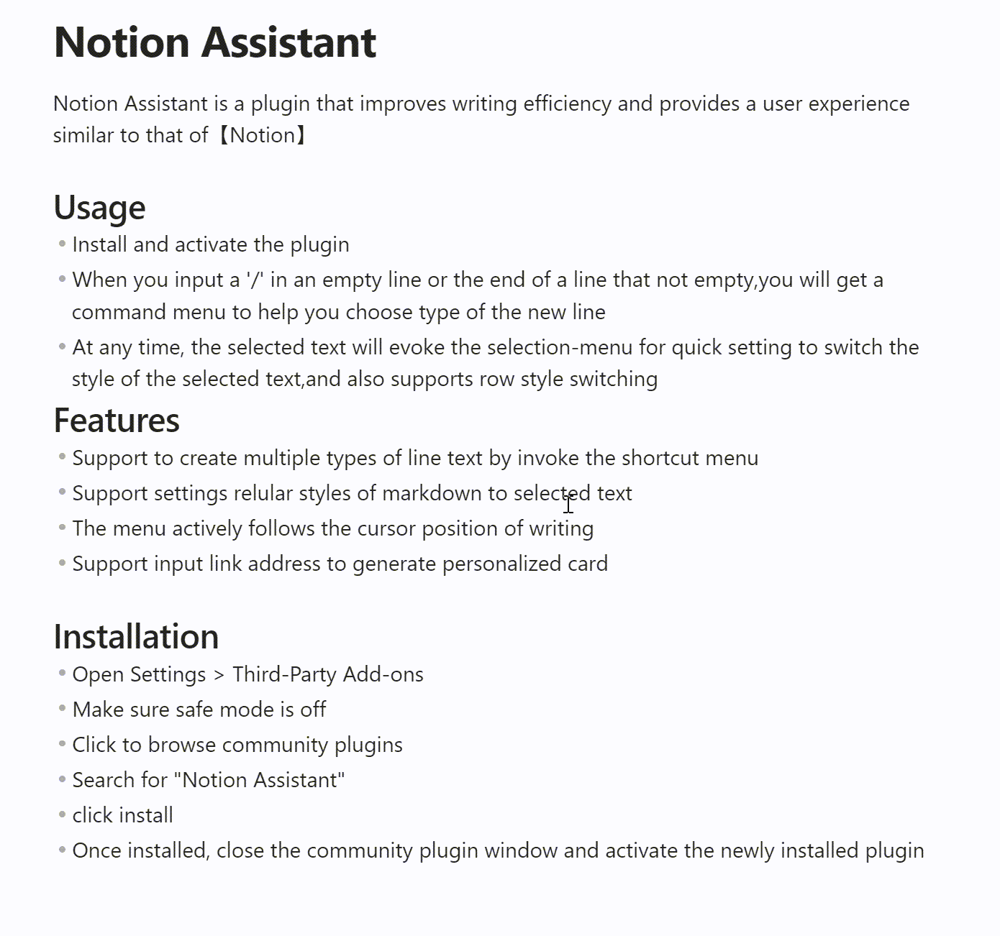

# Typing Assistant
Typing Assistant is a plugin that improves writing efficiency and provides a user experience similar to that of Notion

## Demo 1

## Demo 2
https://github.com/alisahanyalcin/Typing-Assistant/assets/34830846/0994312e-ab97-45b1-b810-d1a9b62b9c40

## Usage
- Install and activate the plugin
- When you input a '/' in an empty line or the end of a line that not empty, you will get a command menu to help you choose type of the new line
- At any time, the selected text will evoke the selection-menu for quick setting to switch the style of the selected text,and also supports row style switching

## Features
- Support to create multiple types of line text by invoke the shortcut menu
- Support settings regular styles of markdown to selected text
- The menu actively follows the cursor position of writing
- Support input link address to generate personalized card
- Supports custom command combinations and drag-and-drop sorting
- Drag visible and hidden commands in one list to set their search order. A command's toggle only controls whether it appears in the initial `/` menu; hidden commands can still be searched and used. Toggling visibility keeps its position, and existing command orders are preserved when upgrading.
- Support quick search of commands

## Installation
- Open Settings > Third-Party Add-ons
- Make sure safe mode is off
- Click to browse community plugins
- Search for "Typing Assistant"
- click install
- Once installed, close the community plugin window and activate the newly installed plugin

## 本地开发

开发版与正式版使用不同的插件标识，可以同时出现在 Obsidian 的已安装插件列表中：

| 模式 | 插件标识（id） | 显示名称 | 输出位置 |
| --- | --- | --- | --- |
| 开发版 | `notion-assistant-plugin` | `Typing Assistant (Dev)` | `dist/notion-assistant-plugin/` |
| 正式版 | `typing-assistant` | `Typing Assistant` | 项目根目录 |

在项目目录运行 `yarn dev`，持续监听源码、`manifest.json` 和 `styles.css` 的变化。首次编译后，开发目录包含 `main.js`、开发版 `manifest.json` 和 `styles.css`。

在笔记库的 `.obsidian/plugins/` 下创建名为 `notion-assistant-plugin` 的软链接，指向项目的 `dist/notion-assistant-plugin` 目录。软链接需要指向开发产物目录，不能再指向项目根目录；根目录的清单仍属于正式版。

重新扫描插件或重新打开笔记库后，启用 `Typing Assistant (Dev)`。两版分别保存设置；调试时关闭正式版，以免两套输入事件同时响应。修改代码并等待编译完成后，关闭再开启开发版以加载新代码。在 macOS 按 `Command+Option+I` 打开 Obsidian 开发者工具，查看日志或调试断点。

`yarn build` 继续生成正式版根目录 `main.js`，发布使用根目录的 `manifest.json` 和 `styles.css`。开发构建不会改写正式版清单。
