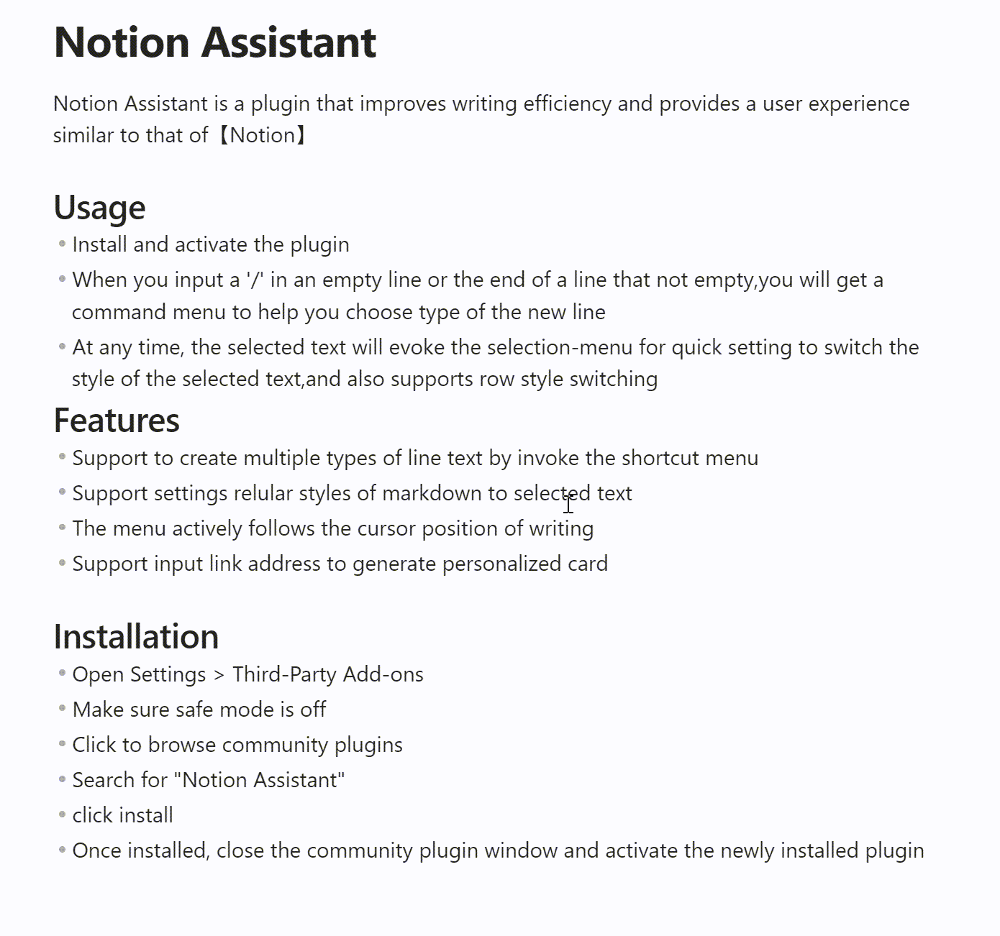

# Typing Assistant for Obsidian

Typing Assistant brings two Notion-style editing shortcuts to Obsidian: type `/` to insert a block, or select text to format it with a floating toolbar. Keep your most-used commands visible and search for the rest when you need them.

[Find Typing Assistant in Obsidian](https://community.obsidian.md/plugins/typing-assistant) · [Release 0.3.1](https://github.com/Jambo2018/notion-assistant-plugin/releases/tag/0.3.1)

## Demo

## Installation

In Obsidian, open **Settings → Community plugins → Browse**, search for **Typing Assistant**, then select **Install** and **Enable**. If Restricted Mode is on, allow community plugins first.

## Quick start

1. On a blank line, type `/`, search for **To-do List**, and press Enter to insert a checkbox.
2. Select a few words in the editor and click **Bold** in the floating toolbar.
3. To customize your menu, open **Settings → Typing Assistant → Commands Menu**.

## Features

- **Slash menu at the cursor.** Insert headings, bulleted or numbered lists, checkboxes, tables, code blocks, and callouts such as Note and Quote. Use the arrow keys to navigate, Enter to run a command, or Esc to close the menu.
- **Searchable commands and custom order.** Choose what appears when you first type `/`. Hidden commands remain searchable. For example, with default settings, typing `/todo` can find **Todo Callout** even though it isn't in the initial menu. It's separate from **To-do List**, which inserts a checkbox.
- **Floating formatting toolbar.** Select text to apply bold, italic, strikethrough, highlight, inline code, or a link. The toolbar also lets you change the current line to a heading, checklist item, or list item.
- **Bookmark cards.** Search for **Link BookMark** and enter a URL to insert a preview card in your note.

## Settings worth knowing

- **Non-empty Line Disabled:** By default, the slash menu can also open at the end of a line with text. Turn this on to trigger it only on blank lines.
- **Typing Placeholder:** Show or hide the hint to type `/` on a blank line.
- **Selection Options:** Turn the floating toolbar on or off. It starts enabled on desktop and disabled on mobile.
- **Commands Menu:** Drag commands to reorder them. The toggles change initial visibility, not whether a command can be searched. Keep at least five commands visible.

## What's new in 0.3.1

Visible and hidden commands now share one reorderable list. You can move a hidden command above a visible one in search results, and changing a command's visibility no longer moves it. Existing command order is preserved when you upgrade.
